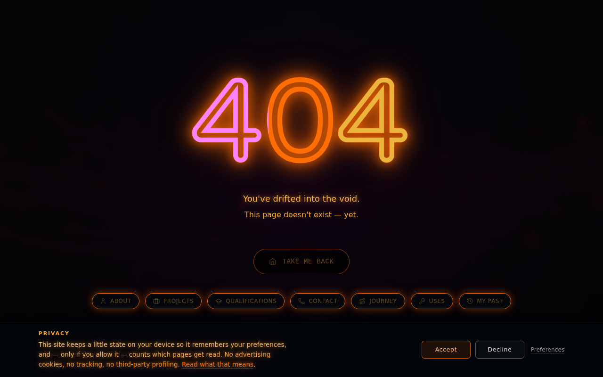
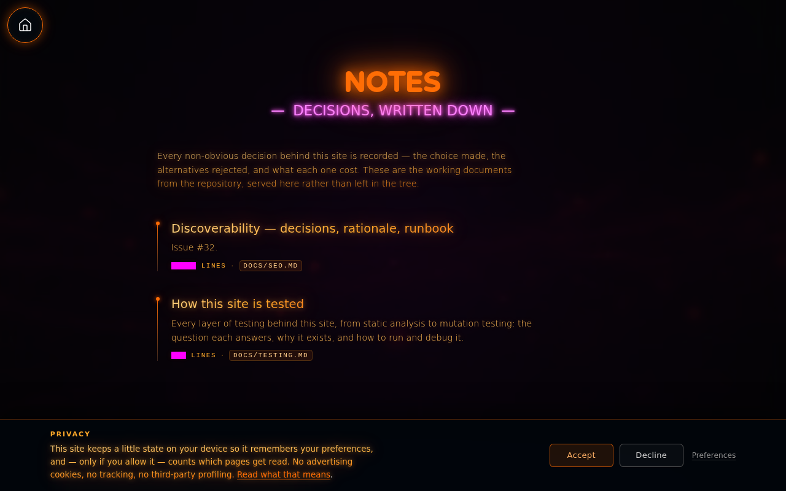
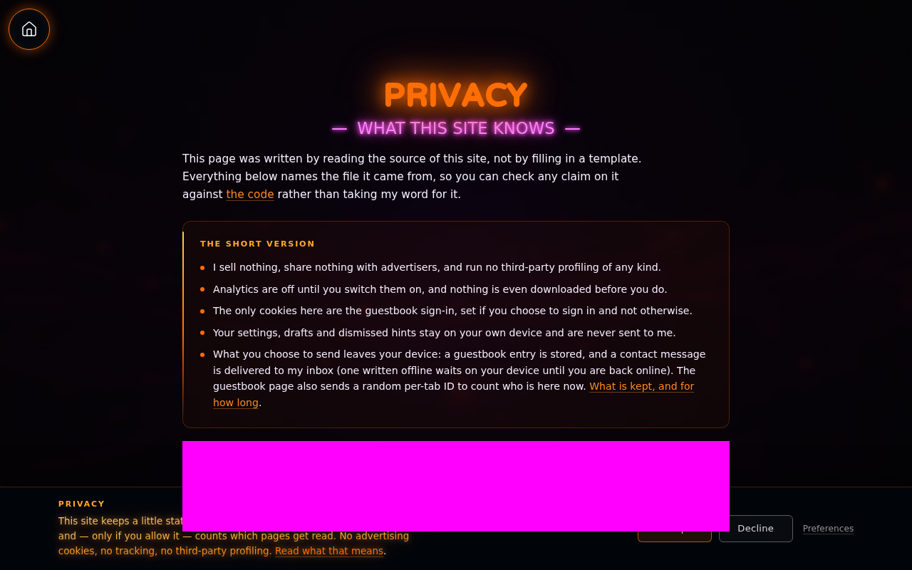

# Latest visual render

Rendered for `8f1f707` by `.github/workflows/visual-baselines.yml` on every push (issue #92).
These are the CURRENT screenshots. The reviewed baselines CI compares against live in
`../__screenshots__/`; promote a render to baseline by running the workflow with `promote: true`.

**4 view(s) differ from their baseline.** Review them, then promote or fix.

| View | Status | Size |
|---|---|---:|
| `pages.spec.js/contact.png` | ⚠️ differs from baseline | 197 kB |
| `pages.spec.js/cv.png` | ✅ matches baseline | 272 kB |
| `pages.spec.js/not-found.png` | ⚠️ differs from baseline | 233 kB |
| `pages.spec.js/notes-index.png` | ⚠️ differs from baseline | 234 kB |
| `pages.spec.js/privacy.png` | ⚠️ differs from baseline | 217 kB |

### pages.spec.js/contact.png

### pages.spec.js/cv.png

### pages.spec.js/not-found.png

### pages.spec.js/notes-index.png

### pages.spec.js/privacy.png

